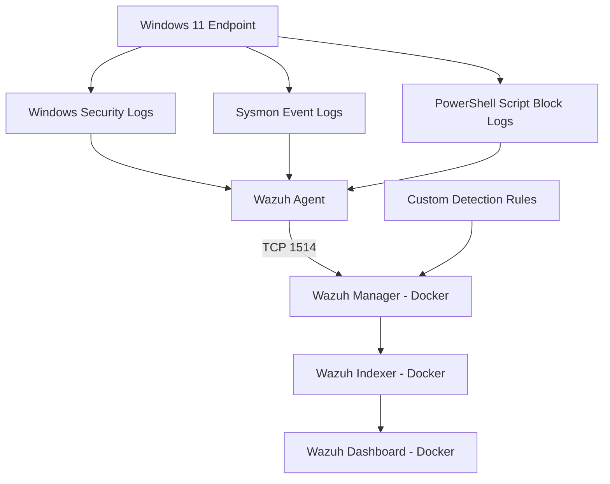

# SOC Detection Lab Architecture

## Detection Rules
- 100100: Repeated Failed Logins
- 100101: Suspicious PowerShell Execution
- 100102: Unusual Parent-Child Process Behavior

## Technology Stack
- Windows 11
- Sysmon
- Windows Event Logging
- PowerShell Script Block Logging
- Wazuh Agent
- Wazuh Manager, Indexer, and Dashboard
- Docker Desktop

